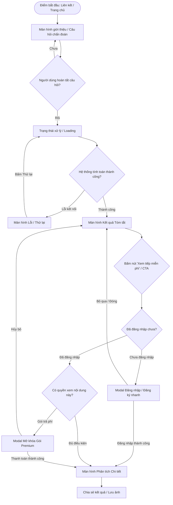

# USER FLOW SPECIFICATIONS

> **Quy chuẩn Luồng Người dùng**: Định rõ hành trình người dùng từ điểm bắt đầu qua từng quyết định, hành động và màn hình tiếp theo. Bao gồm đầy đủ các nhánh thành công, thất bại, chưa đăng nhập và điều hướng quay lại, ngăn chặn tình trạng ngõ cụt (dead-end).

---

## 1. Sơ Đồ Tổng Thể Luồng Trải Nghiệm (Master Journey Map)

---

## 2. Chi Tiết Từng Luồng Người Dùng (Detailed User Flows)

### 2.1 Luồng 1: Khám phá & Nhận Kết quả (Discovery to Result Flow)
- **Điểm bắt đầu (Entry Point)**: 
  - Người dùng truy cập URL bài test / chẩn đoán (ví dụ: `pattern16_Story Steps`).
- **Hành động (Action)**:
  - Xem câu hỏi, chọn đáp án, bấm "Xem kết quả".
- **Màn hình tiếp theo (Next Screen)**:
  - Hiển thị màn hình kết quả chẩn đoán với hình ảnh linh vật (Mascot Chibi), danh hiệu/nhận xét ngắn.
- **Các nhánh rẽ (Branches)**:
  - **Nhánh thành công (Happy Path)**: Dữ liệu tải nhanh dưới 1.5s, hình ảnh hiển thị sắc nét, xuất hiện đoạn nhận xét cùng nút CTA chính.
  - **Nhánh lỗi (Error Path)**: Lỗi tải ảnh hoặc không lấy được kết quả từ máy chủ $\to$ Hiển thị khung placeholder kèm nút `[Thử lại]`.
  - **Nhánh quay lại (Back Navigation)**: Bấm nút Back trên trình duyệt hoặc nút `[Quay lại]` trên header $\to$ Giữ nguyên trạng thái câu trả lời trước đó, không bắt người dùng nhập lại từ đầu.

---

### 2.2 Luồng 2: Mở khóa Nội dung Chi tiết qua CTA (Conversion / Unlock Flow)
- **Điểm bắt đầu**:
  - Người dùng cuộn đến cuối màn hình kết quả tóm tắt tại khối: *「自分自身をもっと深く知る」* (Tìm hiểu sâu hơn về bản thân).
- **Hành động**:
  - Nhấp vào nút CTA nổi bật: *「無料で続きを見る」* (Xem tiếp miễn phí) hoặc *「プレミアム版を解放する」*.
- **Kiểm tra trạng thái (Decision Points)**:
  1. **Trường hợp ĐÃ đăng nhập & Đủ điều kiện**:
     - Hiển thị hiệu ứng mở khóa (Unlock animation) $\to$ Trực tiếp mở rộng nội dung chi tiết hoặc điều hướng sang trang kết quả đầy đủ.
  2. **Trường hợp CHƯA đăng nhập**:
     - Hiển thị Bottom Sheet (trên Mobile) hoặc Modal (trên Desktop) hỗ trợ đăng nhập 1-chạm (Google / Apple / LINE).
     - Sau khi đăng nhập hoàn tất: Tự động đưa người dùng trở lại đúng vị trí nội dung cần xem mà không yêu cầu nhấp CTA lần thứ hai.
  3. **Trường hợp Cần nâng cấp gói (Paywall)**:
     - Hiển thị bảng so sánh quyền lợi gói Free vs Premium.
     - Nút thanh toán nhanh $\to$ Điều hướng tới cổng thanh toán an toàn $\to$ Quay lại trang kết quả đã mở khóa.

---

### 2.3 Luồng 3: Tương tác Chia sẻ & Lưu trữ (Share & Export Flow)
- **Điểm bắt đầu**:
  - Nút chia sẻ (Share Icon / Button) tại thanh điều hướng hoặc cạnh kết quả.
- **Hành động**:
  - Bấm chọn nền tảng chia sẻ (Facebook, Zalo, LINE, X) hoặc "Tải ảnh về máy".
- **Các nhánh xử lý**:
  - **Web Share API được hỗ trợ (Mobile)**: Bật trình chia sẻ hệ thống nguyên bản (Native Share Sheet).
  - **Trình duyệt Desktop không hỗ trợ Web Share API**: Tự động sao chép liên kết vào clipboard và hiển thị Toast thông báo *"Đã sao chép liên kết thành công!"*.
  - **Lỗi tạo ảnh chia sẻ**: Báo lỗi nhẹ nhàng và cho phép chia sẻ dạng link thuần.

---

## 3. Ma Trận Chuyển Đổi Trạng Thái Màn Hình (State Transition Matrix)

| Màn hình hiện tại | Hành động của người dùng | Điều kiện / Ràng buộc | Màn hình / Modal đích | Trạng thái hiển thị |
| :--- | :--- | :--- | :--- | :--- |
| `SCR-001` (Trang chủ/Test) | Chọn đáp án & Bấm Hoàn tất | Hợp lệ | `SCR-002` (Loading) | Shimmer / Skeleton Animation |
| `SCR-002` (Loading) | Xử lý xong thành công | Không lỗi | `SCR-003` (Kết quả Tóm tắt) | Hiển thị Mascot + Text + CTA |
| `SCR-002` (Loading) | Xử lý thất bại / Mất mạng | Timeout / 500 | `SCR-ERR` (Màn hình Lỗi) | Nút "Tải lại trang" |
| `SCR-003` (Kết quả) | Bấm CTA "Xem tiếp miễn phí" | Đã đăng nhập | `SCR-004` (Kết quả Chi tiết) | Mở khóa toàn văn phân tích |
| `SCR-003` (Kết quả) | Bấm CTA "Xem tiếp miễn phí" | Chưa đăng nhập | `MODAL-AUTH` (Đăng nhập) | Bottom Sheet mượt mà |
| `MODAL-AUTH` | Đăng nhập thành công | Xác thực OK | `SCR-004` (Kết quả Chi tiết) | Tự động chuyển tiếp |
| `MODAL-AUTH` | Bấm dấu [X] / Vuốt đóng | Người dùng hủy | `SCR-003` (Kết quả Tóm tắt) | Trở lại màn hình kết quả |
| Bất kỳ màn hình nào | Bấm Back trên trình duyệt | Lịch sử có trang trước | Màn hình trước đó | Lưu giữ dữ liệu phiên (Cache) |

---

## 4. Nguyên Tắc Trải Nghiệm Xuyên Suốt (UX Continuity Principles)

1. **Không Dead-End**: Mọi màn hình lỗi, trang trống hoặc modal đều phải có ít nhất một lối thoát rõ ràng (nút "Quay lại", "Trở về Trang chủ", hoặc "Thử lại").
2. **Bảo tồn dữ liệu đã nhập (Preserve State)**: Khi quay lại bước trước, mọi lựa chọn của người dùng phải được giữ nguyên vẹn, không được reset trắng.
3. **Phản hồi tức thì (Instant Feedback)**: Mọi thao tác chạm/click vào nút bấm đều phải có phản hồi thị giác ngay lập tức ($< 100\text{ms}$) qua hiệu ứng active/pressed hoặc chỉ báo đang tải.
